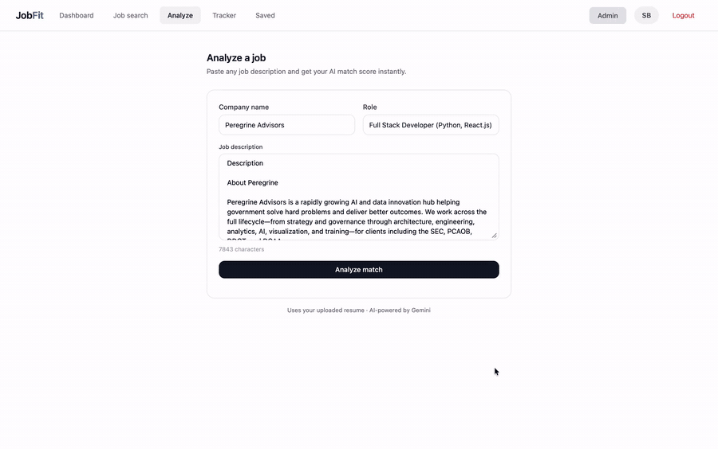
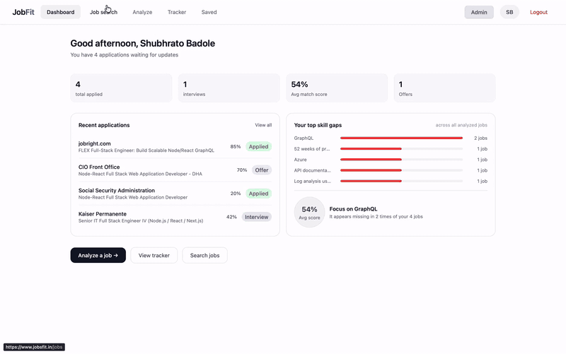
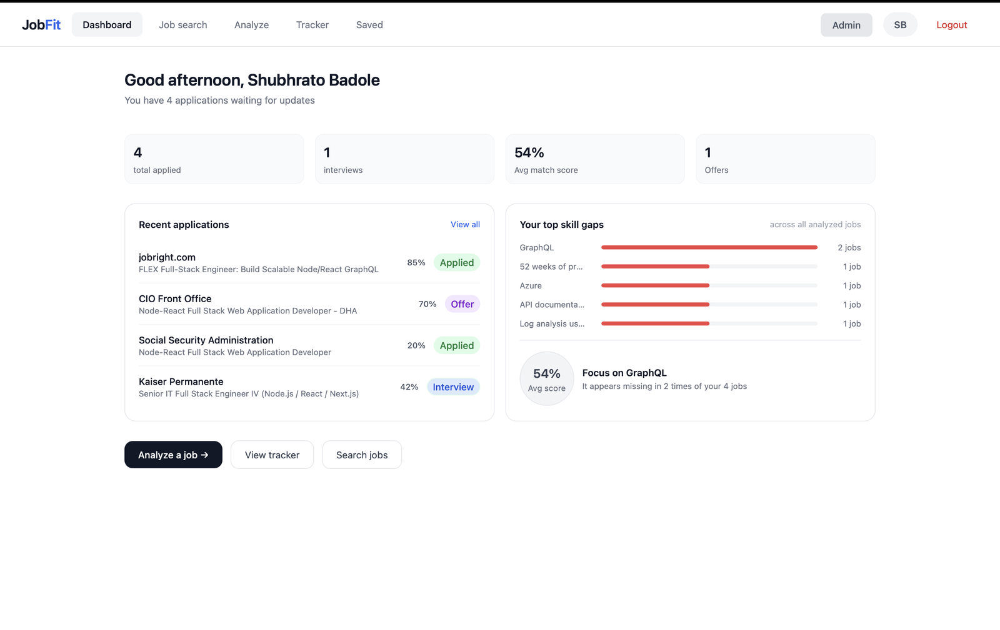
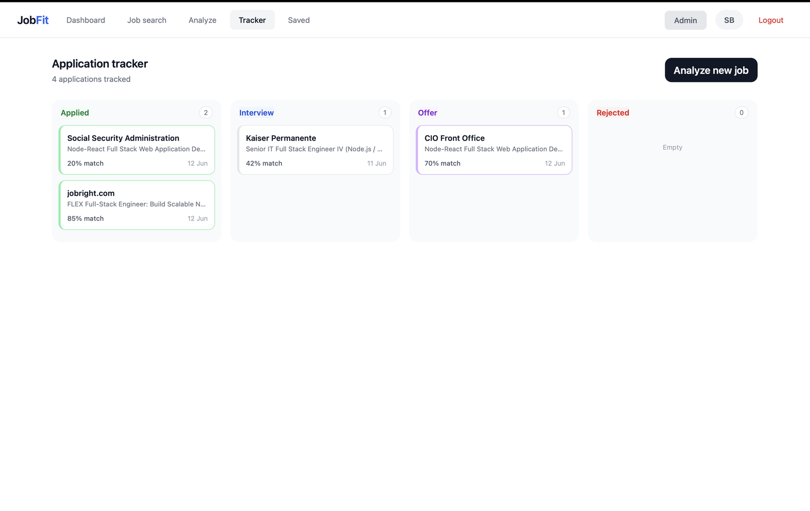
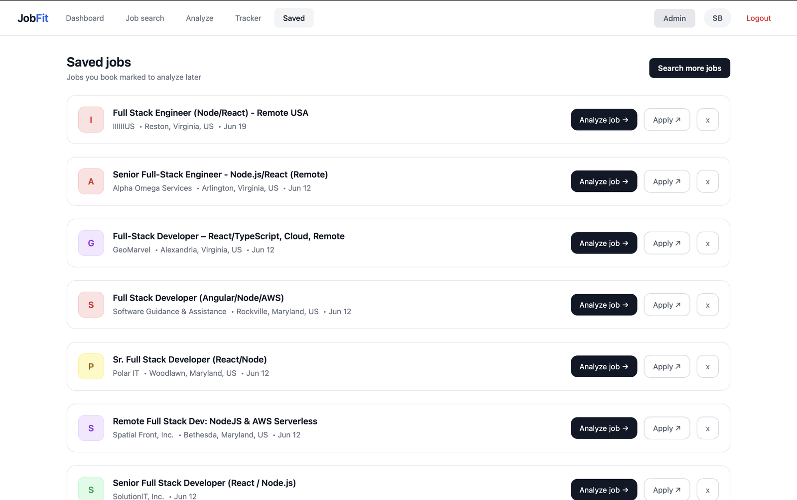
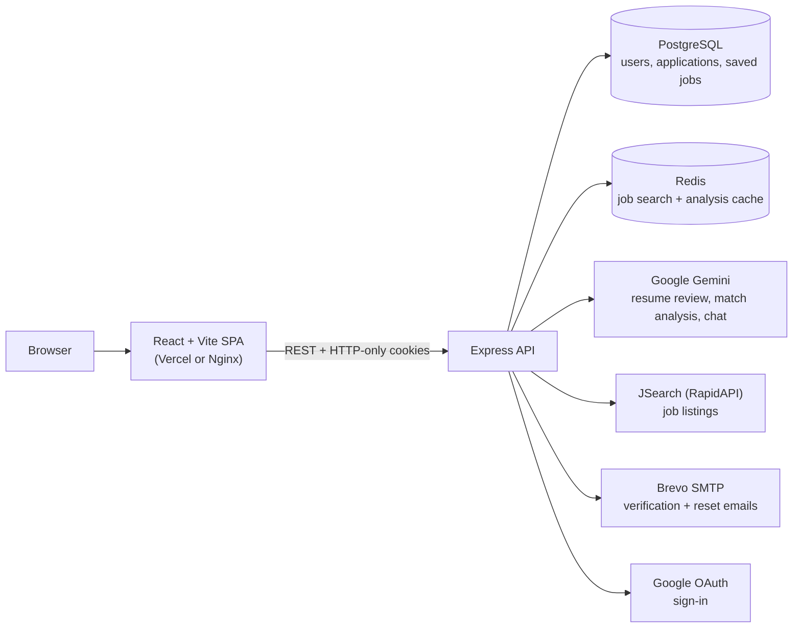
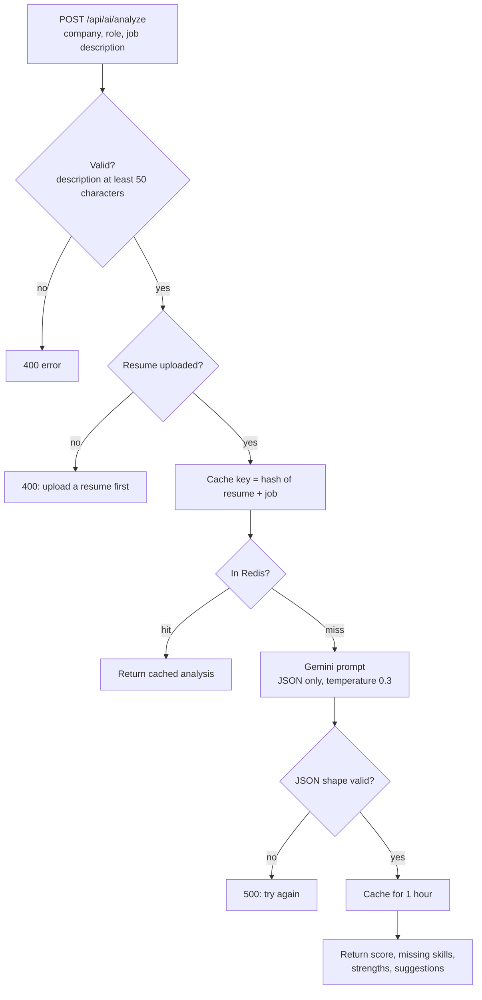

<div align="center">

# JobFit

**Know exactly why you're not getting callbacks.**

Upload your resume once, search real job listings, and get an AI match score that shows which skills you're missing and what to do about it. Track every application on a Kanban board.


[Live demo](https://job-fit-murex.vercel.app) · [Features](#features) · [How it works](#how-it-works) · [Quick start](#quick-start) · [API](#api-overview) · [Limitations](#limitations-and-roadmap)

</div>

<p align="center">
  
  <br />
  <sub>Paste a job description and get a match score, missing skills, strengths and next steps.
  Full-quality MP4s: <a href="docs/videos/demo-analyze.mp4">analyze</a> · <a href="docs/videos/demo-search.mp4">job search</a>.</sub>
</p>

## Why JobFit?

You send applications and hear nothing back, without knowing whether the problem is your resume, the role or the skills you lack. JobFit compares your resume with the actual job description and tells you.

1. **Upload your resume** (PDF). It gets an AI review: a score, strengths, fixes and three target roles.
2. **Find or paste a job.** Search live listings, or paste any job description.
3. **Get a match score.** See the skills you're missing, the strengths you already have, and three concrete improvements. Then chat with an AI career coach about the result.
4. **Track the outcome.** Move each application through Applied, Interview, Offer or Rejected, and watch your most common skill gaps on the dashboard.

## Screenshots and demos

<table>
  <tr>
    <td width="50%" align="center" valign="top">
      <br />
      <sub><b>Job search.</b> Search listings, then analyze, save or apply from each card.</sub>
    </td>
    <td width="50%" align="center" valign="top">
      <br />
      <sub><b>Dashboard.</b> Totals, average match score, recent applications and your most frequent skill gaps.</sub>
    </td>
  </tr>
  <tr>
    <td width="50%" align="center" valign="top">
      <br />
      <sub><b>Application tracker.</b> A Kanban board with the match score stored on every card.</sub>
    </td>
    <td width="50%" align="center" valign="top">
      <br />
      <sub><b>Saved jobs.</b> Bookmark listings now and analyze them later.</sub>
    </td>
  </tr>
</table>

## Table of contents

- [Features](#features)
- [How it works](#how-it-works)
- [Tech stack](#tech-stack)
- [Quick start](#quick-start)
- [Configuration](#configuration)
- [API overview](#api-overview)
- [Database](#database)
- [Performance and observability](#performance-and-observability)
- [Deployment](#deployment)
- [Limitations and roadmap](#limitations-and-roadmap)
- [Contributing](#contributing)
- [License](#license)

## Features

### Match your resume to any job
- **Resume review**: upload a PDF (up to 5 MB). Text is extracted, then Gemini returns a 0-100 score, strengths, specific fixes and exactly three target roles.
- **Job match analysis**: paste a company, role and job description. You get a 0-100 match score, missing skills, matching strengths and three actionable suggestions.
- **Chat with AI**: a career-coach chatbot that knows your resume, the job and the analysis, so you can ask follow-up questions.

### Find and manage jobs
- **Job search** through the JSearch API on RapidAPI, with quick-search chips and an optional location.
- **Save jobs** to analyze later, or send an analysis straight to the tracker.
- **Application tracker**: Applied, Interview, Offer and Rejected columns with the match score on each card.
- **Dashboard**: total applications, interviews, offers, average match score, recent applications, and your top skill gaps counted across every analyzed job.

### Accounts and administration
- **Sign-up with email verification**, forgot and reset password, and **Google sign-in**.
- **Sessions** use short-lived JWT access tokens and refresh tokens in HTTP-only cookies.
- **Profile**: update your name, change your password, delete your account.
- **Admin stats** endpoint and page, restricted to users with the `admin` role.

### Built for responsiveness and safety
- **Redis caching** for job searches (30 minutes) and AI analyses (1 hour).
- **Input validation** with Zod, request-rate limiting, Helmet security headers and a CORS allowlist.
- **Bcrypt** password hashing, and verification and reset tokens stored only as SHA-256 hashes.

## How it works



### Life of a match analysis



**Design decisions worth knowing**

| Decision | Why |
|---|---|
| Resume stored as extracted text, not the PDF | Uploads are held in memory only, so no files are written to disk, and the text is reused by every analysis and chat. |
| Prompts demand JSON only, and the response shape is validated | A malformed AI reply returns a clean error instead of breaking the UI. |
| Analyses are cached by a hash of resume + job inputs | Re-analyzing the same job with the same resume costs no extra AI call. |
| Job-search responses carry an `X-Cache` header (`HIT`, `MISS`, `BYPASS`, `ERROR`) | Cache behavior is easy to observe and benchmark. |
| Access token 30 min, refresh token 7 days | The refresh token reissues both cookies when the access token expires. |
| Auth and delete routes limited to 10 requests per 15 minutes per IP | Slows down brute-force attempts. |

> [!NOTE]
> **Where your data goes.** Your resume text and job descriptions are sent to Google's Gemini API for analysis. They are stored in your PostgreSQL database and cached in Redis.

## Tech stack

| Layer | Technology |
|---|---|
| **Frontend** | React 19, Vite, Tailwind CSS 3, React Router 7, Axios, Radix UI |
| **Backend** | Node.js 20, Express 5, Passport (Google OAuth 2.0), Zod, Helmet, express-rate-limit |
| **Auth** | JWT (jsonwebtoken), bcrypt, HTTP-only cookies, Nodemailer with the Brevo SMTP relay |
| **AI** | Google Gemini (`gemini-flash-latest` for analysis, `gemini-3.5-flash` for chat) |
| **Jobs data** | JSearch API on RapidAPI (US listings, two result pages per search) |
| **Data** | PostgreSQL 15, Redis 7 (ioredis) |
| **Files** | Multer (in-memory), pdf-parse |
| **DevOps** | Docker, Docker Compose, Nginx, Vercel config for the client, k6 benchmark script |

## Quick start

### Prerequisites

| Needed | For |
|---|---|
| [Docker](https://docs.docker.com/get-docker/) with Compose v2 | Running everything with one command |
| [Gemini API key](https://aistudio.google.com/apikey) | Resume review, match analysis and chat |
| [RapidAPI](https://rapidapi.com/) key subscribed to JSearch | Job search |
| [Brevo](https://www.brevo.com/) SMTP credentials | Verification and password-reset emails |

Optional: a Google OAuth client for "Continue with Google". For local development without Docker you also need Node.js 20.

### Run with Docker Compose

```bash
git clone https://github.com/shubhrato-badole/JobFit.git
cd JobFit

# 1. Create your env files from the templates
cp server/.env.example server/.env
cp client/.env.example client/.env

# 2. Fill in the required values in server/.env (see Configuration below)

# 3. Build and start Nginx, the client, the API, PostgreSQL and Redis
docker compose up --build
```

| Service | URL |
|---|---|
| Web app (Nginx) | http://localhost |
| API (direct) | http://localhost:3000 |
| PostgreSQL (host port) | `localhost:5433` |
| Redis (host port) | `localhost:6380` |

The database tables are created automatically on the first start.

> [!TIP]
> **No SMTP credentials yet?** Register, then verify the account by hand:
> `docker compose exec postgres psql -U postgres -d jobfit -c "UPDATE users SET is_verified = true WHERE email = 'you@example.com';"`

> [!TIP]
> **Make yourself an admin** to open the Admin page:
> `docker compose exec postgres psql -U postgres -d jobfit -c "UPDATE users SET role = 'admin' WHERE email = 'you@example.com';"`

> [!NOTE]
> Sessions use `Secure` cookies. Chrome accepts them on `http://localhost`; some other browsers do not, so use Chrome for local testing.

### Run locally for development

```bash
# Infrastructure only (tables are created on first start)
docker compose up -d postgres redis

# API
cd server
npm install
npm run dev                  # http://localhost:3000

# Web app (new terminal)
cd client
npm install
npm run dev                  # http://localhost:5173
```

For this setup, change these values:

| File | Variable | Value |
|---|---|---|
| `server/.env` | `CLIENT_URL` | `http://localhost:5173` |
| `server/.env` | `CORS_ORIGINS` | `http://localhost:5173` |
| `server/.env` | `GOOGLE_CALLBACK_URL` | `http://localhost:3000/api/auth/google/callback` |
| `client/.env` | `VITE_API_URL` | `http://localhost:3000` |

## Configuration

Copy `server/.env.example` to `server/.env` and `client/.env.example` to `client/.env`. Never commit real `.env` files; they are already in `.gitignore`.

<details>
<summary><strong>All environment variables</strong></summary>

**Server (`server/.env`)**

| Variable | Required | Description |
|---|---|---|
| `GEMINI_API_KEY` | Yes | Gemini key for resume review and match analysis |
| `GEMINI_CHATBOT_KEY` | Yes | Gemini key for the chat feature (can be the same key) |
| `RAPID_API_KEY` | Yes | RapidAPI key with a JSearch subscription |
| `JWT_SECRET_ACESSTOKEN` | Yes | Secret for access tokens (the spelling matches the code) |
| `JWT_SECRET_REFRESHTOKEN` | Yes | Secret for refresh tokens |
| `DATABASE_URL` | Yes (local) | PostgreSQL connection string. Docker Compose sets this for you |
| `REDIS_URL` | Yes (local) | Redis connection string. Docker Compose sets this for you |
| `DATABASE_SSL` | No | Set to `false` for a local PostgreSQL. Leave unset for managed databases, which need SSL |
| `REDIS_TLS` | No | Set to `false` for a local Redis. Leave unset for managed Redis, which needs TLS |
| `CORS_ORIGINS` | Yes | Comma-separated list of allowed browser origins |
| `CLIENT_URL` | Yes | Public URL of the web app, used in emails and the Google sign-in redirect |
| `EMAIL_USER`, `EMAIL_PASS` | Yes | Brevo SMTP credentials for verification and reset emails |
| `GOOGLE_CLIENT_ID`, `GOOGLE_CLIENT_SECRET`, `GOOGLE_CALLBACK_URL` | No | Google sign-in. Callback path: `/api/auth/google/callback` |
| `PORT` | No | API port. Default `3000` |

Generate a JWT secret with: `node -e "console.log(require('crypto').randomBytes(48).toString('hex'))"`

**Client (`client/.env`)**

| Variable | Description |
|---|---|
| `VITE_API_URL` | API origin. Leave it empty when Nginx serves both (Docker Compose). Use `http://localhost:3000` for `npm run dev` |

</details>

## API overview

All routes live under `/api`. Everything except registration, login, email verification, password reset and Google sign-in requires the HTTP-only auth cookie.

| Prefix | Purpose |
|---|---|
| `/api/auth` | `register`, `verify-email`, `resend-verification`, `login`, `logout`, `me`, `forgot-password`, `verify-password`, `reset-password`, `google`, `google/callback` |
| `/api/resume` | `POST /upload` (PDF in the `resume` field, 5 MB max), `GET /status` |
| `/api/ai` | `POST /analyze` (company, role, jobDesc), `POST /tracker` (save an analysis as an application) |
| `/api/jobs` | `GET /search?q=...`, `GET /saved`, `POST /saved`, `DELETE /:id` |
| `/api/tracker` | `GET /`, `PATCH /:id` (change status), `DELETE /:id` |
| `/api/dashboard` | `GET /user` (totals, average score, recent applications, top skill gaps) |
| `/api/chat` | `POST /` (message, history, jobDesc, analysisResult) |
| `/api/profile` | `GET /`, `PATCH /change`, `PATCH /password`, `DELETE /delete` |
| `/api/admin` | `GET /stats` (admin role only) |

<details>
<summary><strong>Example: analyze a job</strong></summary>

```http
POST /api/ai/analyze
{ "company": "Peregrine Advisors", "role": "Full Stack Developer", "jobDesc": "…at least 50 characters…" }
```

```json
{
  "matchScore": 32,
  "missingSkills": ["Python", "AWS Lambda", "…"],
  "strengths": ["React.js frontend development", "…"],
  "suggestions": ["…", "…", "…"]
}
```

</details>

## Database

Three tables, created from [`server/database/schema.sql`](server/database/schema.sql):

| Table | Holds |
|---|---|
| `users` | Account, role, verification state, extracted resume text, resume score, feedback and target roles |
| `applications` | Tracked jobs: company, role, status, match score, missing skills, strengths, suggestions |
| `saved_jobs` | Bookmarked listings per user |

Indexes cover `applications.user_id`, `applications.status`, `saved_jobs.user_id` and `users.email`.

## Performance and observability

- Job-search responses include an `X-Cache` header, so you can see whether Redis served the request.
- Requests to `/api/jobs/search` and `/api/ai/analyze` are timed and logged as `[PERFORMANCE] METHOD path | status | duration`.
- [`server/src/tests/benchmark.js`](server/src/tests/benchmark.js) is a [k6](https://k6.io/) script that measures cache hit, miss and bypass latency on job search:

```bash
BASE_URL=http://localhost COOKIE="accessToken=...; refreshToken=..." VUS=1 ITERATIONS=10 \
  k6 run server/src/tests/benchmark.js
```

## Deployment

- **Single host**: `docker compose up -d --build` runs Nginx (port 80), the client, the API, PostgreSQL and Redis. Nginx sends `/api/` to the API and everything else to the web app.
- **Split hosting**: the client ships with a `vercel.json` for Vercel, and the API runs behind a proxy (the server trusts one proxy hop). Use managed PostgreSQL and Redis there, leave `DATABASE_SSL` and `REDIS_TLS` unset, and set `CORS_ORIGINS` and `CLIENT_URL` to your client's URL.

## Limitations and roadmap

**Known limitations**

- Resumes must be text-based PDFs up to 5 MB. Scanned images are rejected, and the text limit is 50,000 characters.
- Job search is pinned to US listings (`country=us`).
- The chat assistant sees only the first 1,000 characters of your resume.
- Scores come from a language model, so treat them as guidance rather than a verdict.
- There is no automated test suite yet, and no published benchmark results (only the k6 script).

**Ideas**

- Support DOCX resumes and OCR for scanned PDFs.
- Let users choose a country for job search.
- Add unit and integration tests, and a CI pipeline.

## Contributing

Contributions are welcome.

1. Fork the repo and create a branch: `git checkout -b feature/my-change`.
2. Make your change and run the app locally to check it.
3. Open a pull request describing what changed and why. For larger changes, open an issue first.

Found a bug or have an idea? [Open an issue](https://github.com/shubhrato-badole/JobFit/issues).

## License

Released under the [MIT License](LICENSE). Copyright © 2026 Shubhrato Badole.

---

<div align="center">

Built by [Shubhrato Badole](https://github.com/shubhrato-badole)

</div>
